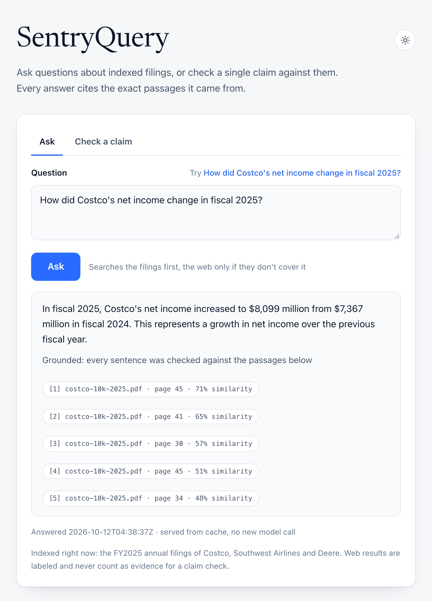
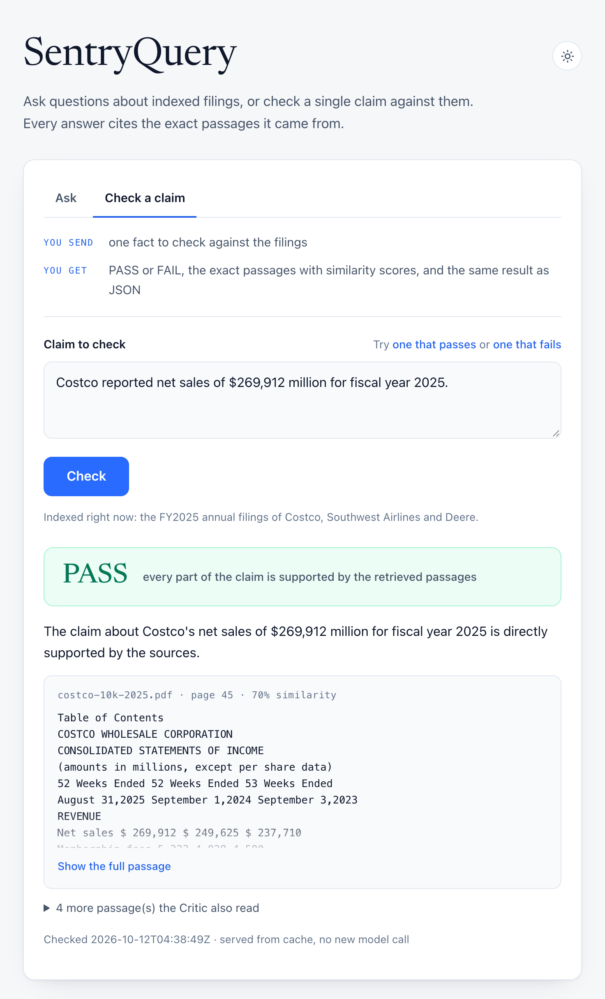
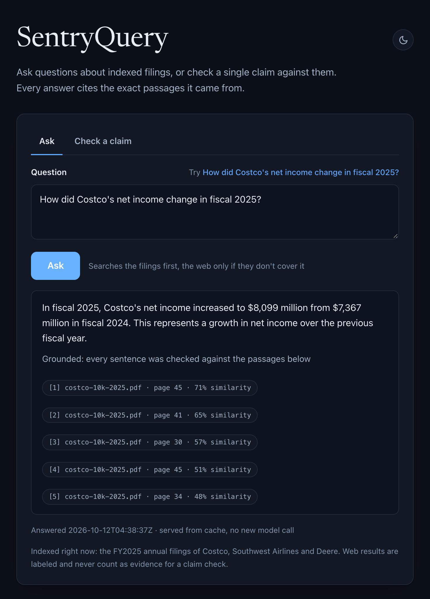
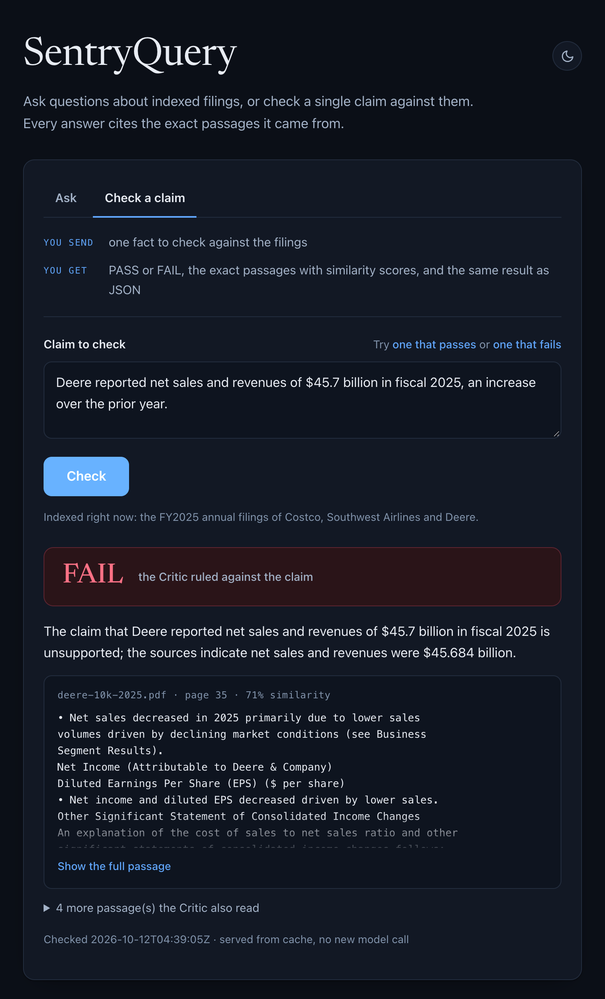
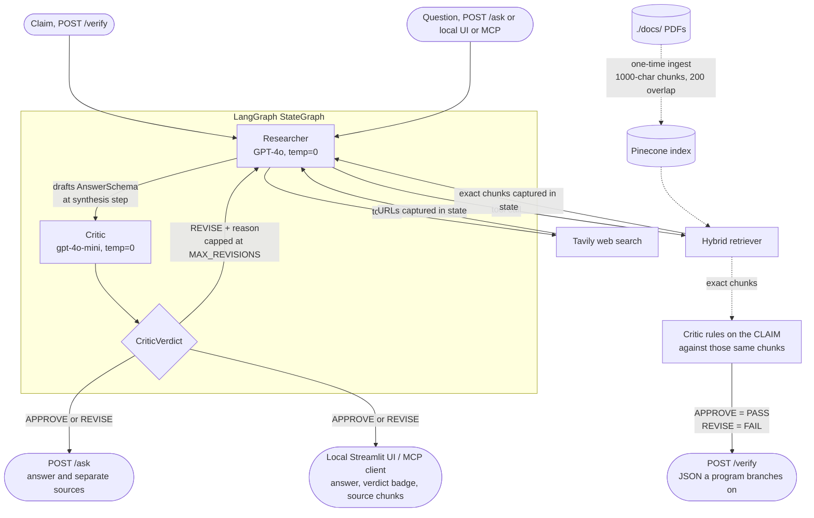

# SentryQuery

[](https://github.com/henry-hai/SentryQuery-AI/actions/workflows/ci.yml)

A site for asking questions about indexed filings and checking claims against
them. Ask returns an answer with its source passages. Check a claim returns PASS
or FAIL with the exact passages behind the verdict, as JSON a program can branch
on. A **Researcher** retrieves passages, and a **Critic** checks what they support.

**Live site: https://sentryquery.onrender.com**

The site has two tabs. **Ask** answers from the filings and cites every passage it used.
**Check a claim** returns PASS or FAIL with the passage the Critic read.





It has a dark mode and keeps your choice.





## Architecture



Questions and claims share one graph and one function:

```python
critique(critic_llm, answer_or_claim, chunks) -> CriticVerdict
```

A question runs the full loop and the Critic judges the Researcher's draft. A
claim uses the Researcher only to gather passages, then the Critic judges the
claim itself against those same chunks. Neither path re-queries the index to
build its evidence, because re-fetching fresh text would defeat the check.

Retrieval is a tool the Researcher decides to call, not a fixed step, and it can
call it more than once with refined queries. The answer is packaged into a
Pydantic `AnswerSchema` at a separate synthesis step, so the tool-calling loop
stays intact.

On REVISE the graph loops back to the Researcher, capped at `MAX_REVISIONS`
(default 1). The Critic runs on `gpt-4o-mini` because groundedness checking is
narrower than answering, at `temperature=0` for reproducible verdicts.

## API

`POST /ask` takes `{"question": "..."}` and returns the answer, the Critic's
APPROVE or REVISE with its reason, numbered document passages with pages and
similarity scores, and any web URLs labeled separately. Web results never count
as claim-check evidence.

`POST /verify` takes one statement and returns a verdict and the passage it was
judged against.

```
curl -s -X POST https://sentryquery.onrender.com/verify \
  -H 'Content-Type: application/json' \
  -d '{"claim": "Deere reported net sales and revenues of $45.7 billion in fiscal 2025, an increase over the prior year."}'
```

```json
{
  "verdict": "FAIL",
  "reason_code": "critic_rejected",
  "reason": "The claim that net sales and revenues were $45.7 billion in fiscal 2025 is supported, but the statement that this represents an 'increase over the prior year' is unsupported.",
  "evidence": [
    {
      "document": "deere-10k-2025.pdf",
      "page": 46,
      "passage": "SELECTED FINANCIAL DATA\n  2025     2024 2023\nNet sales and revenues   $ 45,684   $ 51,716  $ 61,251"
    }
  ],
  "cached": false,
  "checked_at": "2026-09-17T04:59:24Z"
}
```

The figure is right, $45,684 million rounds to $45.7 billion. The direction is
wrong, since 2024 was $51,716 million. A number that checks out on a trend that
does not is the case a groundedness check has to catch.

| Field | Meaning |
| --- | --- |
| `verdict` | PASS or FAIL. The only field a caller branches on |
| `reason_code` | `null` on PASS. `critic_rejected` when passages came back and the Critic ruled against the claim, `no_evidence` when the best candidate's cosine is below the similarity threshold. Both read off graph state, not model judgment |
| `reason` | The Critic's own words. The wording varies between runs, the verdict does not |
| `evidence` | The exact chunks the Critic ruled against, with document, page and cosine `score`. Never re-queried |
| `cached` | Served from the in-process cache. `checked_at` keeps the original run time |

`no_evidence` is a FAIL, not a third verdict. For a guardrail, "could not be
checked" must not read as approved.

Errors: `400 invalid_claim` for blank or over 1000 characters, `429
rate_limited` with `Retry-After`, `502 upstream_failure`. The cache and a 10 per
minute rate limit are checked before any paid call. Both are in-process and
reset on restart.

## Retrieval

Hybrid search asks Pinecone and a local BM25 index for 8 chunks each and
combines them with reciprocal rank fusion. For a single-company query, a second
vector search runs with the company name stripped, and BM25 uses that text.
Every fused candidate gets a cosine score against the original query. If the
best is below `RETRIEVAL_MIN_SCORE` in `config.py`, `/verify` returns FAIL with
`no_evidence` without calling the Critic. Otherwise the top 5 reach the
Researcher.

When a claim names indexed companies, retrieval is limited to their filings
through `companies.py`. Searches across several companies use vector search
only, with a per-chunk 0.50 cut.

Measured October 6 2026 on 15 questions with verified source pages, hybrid
search raised hit rate at 5 from 0.80 to 0.87 and mean reciprocal rank from 0.62
to 0.80. `evals/retrieval_eval.py` reproduces it, and `--offline` grades the
saved snapshot without keys.

### How the threshold was set

The threshold is **0.50**, applied to the best candidate's cosine.
`evals/score_distribution.py` asks the live index for the top 8 with no
threshold and no filter. Measured October 5 2026 against the three FY2025
filings:

| Query group | Queries | Top score | All 8 scores |
| --- | --- | --- | --- |
| Questions and claims naming an indexed company | 15 | 0.622 to 0.741 | 0.549 to 0.741 |
| The one eval question spanning all three companies | 1 | 0.550 | 0.508 to 0.550 |
| Not indexed, other industry (Apple, Tesla, Nvidia, Microsoft) | 4 | 0.398 to 0.449 | 0.360 to 0.449 |
| Off topic (weather, code, recipes, sport) | 5 | 0.118 to 0.215 | 0.100 to 0.215 |
| Not indexed, same industry (Walmart, Delta, Caterpillar) | 3 | 0.530 to 0.593 | 0.464 to 0.593 |

0.50 sits below every in-corpus hit and above every other-industry and
off-topic query. A score cannot separate the last row. A Walmart claim reads
like the Costco filing, so it clears the threshold, reaches the Critic and fails
as `critic_rejected` rather than `no_evidence`. It still fails.

## Stack

- LangChain agents (`create_agent`) for the Researcher, compiled onto LangGraph
- LangGraph `StateGraph` for the Researcher + Critic graph
- Pydantic for the `AnswerSchema` / `CriticVerdict` contracts
- Pinecone for vector search, OpenAI `text-embedding-3-small` for embeddings
- GPT-4o for the Researcher, `gpt-4o-mini` for the Critic
- Tavily for live web search
- FastAPI and uvicorn for the site and both endpoints, hosted on Render
- Streamlit for the local UI
- The official MCP Python SDK for the Model Context Protocol server
- Docker and Docker Compose for the local run modes
- LangSmith for optional tracing
- GitHub Actions for CI, ruff and pytest

## Run it yourself

The live site covers the three indexed filings. Run it locally to index your
own PDFs, use the MCP server or run the evals.

```
python -m venv venv
source venv/bin/activate    # venv\Scripts\activate on Windows
python -m pip install -r requirements.txt
```

Copy `.env.example` to `.env` and fill in `OPENAI_API_KEY`, `PINECONE_API_KEY`
and `TAVILY_API_KEY`. Pre-create a Pinecone index named `sentry-index`,
dimension `1536`, cosine. Then index `./docs/` once and start the UI:

```
python sentry_query.py --ingest
python -m streamlit run sentry_query.py
```

No company or document name is hard-coded, so the same code runs over whatever
is indexed. For the API, install `requirements-api.txt` and run
`uvicorn api:app --reload`. `render.yaml` deploys the same service.

### MCP server

The same pipeline over the [Model Context Protocol](https://modelcontextprotocol.io),
as one tool, `ask_corpus(question)`. It returns the answer and sources plus the
Critic's verdict and reason, so a client sees the groundedness ruling, not just
text. `mcp_server.py` holds no agent logic.

For Claude Desktop, in `claude_desktop_config.json`, with absolute paths:

```json
{
  "mcpServers": {
    "sentryquery": {
      "command": "/path/to/SentryQuery-AI/venv/bin/python",
      "args": ["/path/to/SentryQuery-AI/mcp_server.py"]
    }
  }
}
```

Keys stay in `.env` and never go in the client config.

### Docker

One non-root image for all three local modes. No key in any layer, Compose
injects them at run time.

```
docker compose up ui                  # http://localhost:8501
docker compose run --rm ingest        # re-index ./docs/
docker compose run --rm -T mcp        # MCP over stdin/stdout
```

## Evaluation

```
python evals/eval.py
```

Runs each case in `evals/qa.json` through the full graph and checks the answer
keyword, retriever routing, `AnswerSchema` validity and the Critic's verdict,
then two direct Critic checks: an ungrounded answer must be REVISE, a grounded
one APPROVE. Claim cases go through `/verify` and are graded on verdict and
`reason_code`, including one about a company that is not indexed, which must
come back `no_evidence`. These are pass counts on 11 checks, not an accuracy
figure.

## Continuous integration

GitHub Actions on every push and PR to `main`: ruff, then an offline pytest
suite with no keys and no secrets. It covers the schema contracts, citation
helpers, eval grading, the Critic's evidence wiring, the MCP layer, both
endpoints with the pipeline stubbed, and scored retrieval against a fake index.

It does not run the Critic's groundedness judgment. That is a live model call,
so it stays in `evals/eval.py`.

## Observability

Every run emits a structured log record: tool routing, verdict, revision count,
confidence. For full tracing, set `LANGSMITH_TRACING=true`, `LANGSMITH_API_KEY`
and `LANGSMITH_PROJECT` in `.env`. Unset, the app runs the same with tracing
off.
